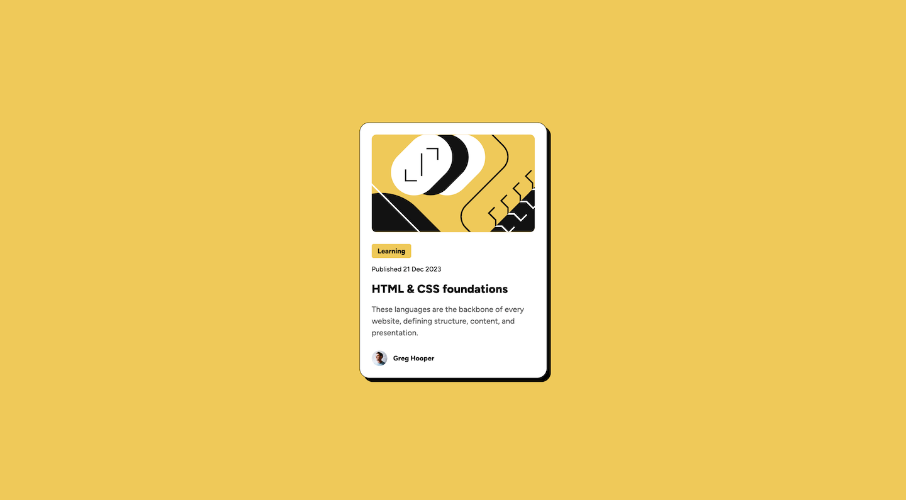
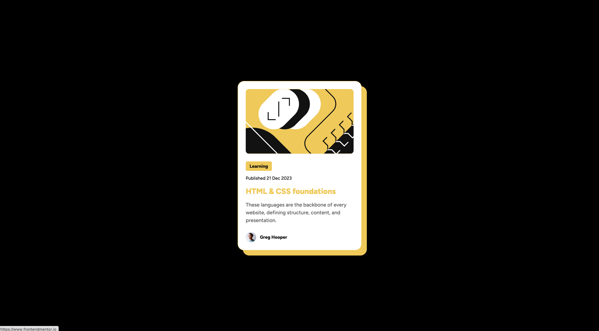

# Frontend Mentor - Blog preview card solution

This is a solution to the [Blog preview card challenge on Frontend Mentor](https://www.frontendmentor.io/challenges/blog-preview-card-ckPaj01IcS).

## Table of contents

- [Overview](#overview)
  - [The challenge](#the-challenge)
  - [Extra feature](#extra-feature)
  - [Screenshot](#screenshot)
  - [Links](#links)
- [My process](#my-process)
  - [Built with](#built-with)
  - [What I learned](#what-i-learned)
  - [AI Collaboration](#ai-collaboration)

## Overview

### The challenge

Users should be able to:

- See hover and focus states for all interactive elements on the page

### Extra feature

**As a** visitor using a mouse on desktop,<br>
**I want to** see the colors change when I hover the card,<br>
**so that** I get visual feedback that I am pointing at it.

### Screenshot

#### Preview


#### Desktop



#### Desktop on hover



### Links

- Repository URL: [GitHub Repo](https://github.com/MATBMS/blog-preview-card)
- Live Site URL: [GitHub Page](https://matbms.github.io/blog-preview-card/)

## My process

### Built with

- Semantic HTML5 markup
- CSS custom properties
- Flexbox
- Mobile-first workflow

### What I learned

#### Alt text for decorative images

Decorative images (like the abstract card illustration) should have an empty `alt` attribute: `alt=""`. It tells screen readers to skip the image, so users don't hear a long description that adds nothing. This is different from having no `alt` at all, which can make a screen reader read the file name out loud.

```html

```

#### Changing the page background when hovering the card

CSS selectors can only style an element or its children, so hovering the card cannot normally change the `body`. The `:has()` selector solves this: `body:has(.card:hover)` means "the body that contains a hovered card". I wrapped it in `@media (hover: hover)` so it only runs on devices with a mouse, not on touch screens.

```css
@media (hover: hover) {
  body:has(.card:hover) {
    background-color: var(--color-black);
  }
}
```

#### `:has()` works with any descendant

In my HTML, the card is not a direct child of the `body`. It is a descendant, two levels down: `body` > `main` > `article.card`. A direct child is only one level down. `:has()` checks all descendants, not only direct children, so `body:has(.card:hover)` still works. This is why it is called a relational selector: it selects an element based on what it contains.

```html
<body>
  <main>
    <article class="card">
```

#### Difference between `noopener` and `noreferrer`

When a link uses `target="_blank"`, it opens in a new tab. Two values of the `rel` attribute protect the visitor, and they do two different things:

- `noopener` stops the new page from controlling my page. Without it, the other site could use `window.opener` to redirect my tab to a fake page.
- `noreferrer` stops the browser from telling the other site which page the visitor came from (the `Referer` header). It also does what `noopener` does.

```html
<a href="https://www.frontendmentor.io/" target="_blank" rel="noopener noreferrer">
```

#### `box-sizing: border-box` includes padding and border

By default (`content-box`), `width` and `height` only measure the content. Padding and border are added on top, so the element ends up bigger than the size I wrote. With `border-box`, the `width` is the total width: the padding and the border are included, and the content area gets smaller instead. Margin is never included.

For example, with `width: 200px`, `padding: 20px` and a `2px` border, the element is 244px wide with `content-box` and 200px wide with `border-box`.

```css
* {
  box-sizing: border-box;
}
```

#### Other concepts to remember

- **`rem` units:** `rem` is relative to the root font size (the `html` element, 16px by default), not to the screen size. If the user changes the font size in the browser, everything in `rem` scales with it.
- **`<article>`:** it is for self-contained content that makes sense on its own, like this blog card. It helps screen readers and search engines understand the page.
- **Mobile-first:** the base CSS is for small screens, and `min-width` media queries add styles for larger screens.

### AI Collaboration

This is a project where I act as the Product Engineer, not the developer. I define the requirements and validate every decision, and Claude Code writes the code.
